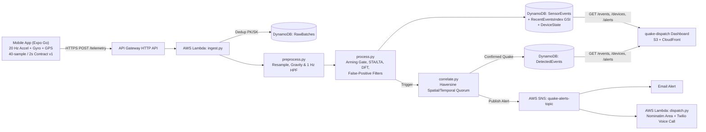

# quake-dispatch — Real-Time Crowdsourced Earthquake Detection & Emergency Dispatch

**Live Dashboard:** https://d263qjwp94jbgt.cloudfront.net  
**API Endpoint:** https://u90us4gdu6.execute-api.eu-central-1.amazonaws.com  
**Presentation:** [`presentation/quake-dispatch.pptx`](presentation/quake-dispatch.pptx)

---

## 1. Solution Description

**quake-dispatch** turns everyday Android and iOS smartphones into a distributed real-time seismic sensor network. Phones stream raw 20 Hz accelerometer, gyroscope, and GPS telemetry to AWS, where a pure-Python cloud pipeline filters out everyday human handling, detects genuine seismic shaking across multiple nearby devices via spatial/temporal quorum, visualizes live network state on a public web dashboard, and automatically alerts responders via **email (AWS SNS)** and an **automated emergency voice dispatch call (Twilio + Amazon Polly + OpenStreetMap reverse geocoding)**.

### End-to-End Architecture



### Key Technical Highlights
- **Edge Collection (`src/mobile/App.tsx`)**: Samples accelerometer (`m/s²`, converted from `g × 9.81`), gyroscope (`rad/s`), and foreground GPS at 20 Hz, packing 40-sample (2-second) columnar Contract v1 batches with `device_id`, `event_type`, `value`, `unit`, and UTC `timestamp`. Includes an indoor GPS fallback (tagged with `accuracy: 999` until real GPS locks), optional `x-api-key` header support, a bounded 20-batch retry queue (drops HTTP `400`/`401`, retries `5xx`/timeouts preserving `t0` for idempotent deduplication), `AbortController` timeouts, and `expo-keep-awake`.
- **Signal Processing & False-Positive Rejection (`src/backend/`)**:
  - `preprocess.py`: Schema/freshness validation, unit normalization, physical bounds check, uniform 20 Hz resampling, gap detection, gravity removal, and 1 Hz high-pass filtering.
  - `process.py`: Per-device arming gate (`DeviceState`), 1-second windowing, RMS, PGA, variance, pure-Python 3-axis signed DFT dominant frequency (1–8 Hz), STA/LTA ratio, sustained multi-second confirmation (`MIN_SUSTAINED_WINDOWS = 2`, `MIN_ACTIVE_FRACTION = 0.50`), and gyroscope/tilt/crest-factor rejection to filter out pocket/hand movement and brief taps.
  - `correlate.py`: Pure-Python Haversine spatial/temporal quorum across nearby active devices with onset synchronization and per-zone cooldown deduplication.
  - `dispatch.py`: Subscribed to `quake-alerts-topic`; reverse-geocodes `(lat, lon)` to a human-readable neighborhood + city via OpenStreetMap Nominatim (with safe coordinate fallback) and places an automated voice dispatch call via Twilio (Polly TTS) or AWS End User Messaging Voice.
- **Web Dashboard (`src/web/quake-dispatch/`)**: Publicly hosted on S3 + CloudFront. Displays live pipeline health (`Sensors → DynamoDB → API` status bar with explicit `503 db_unavailable` detection), device context (IDs, armed/unarmed status, locality, interactive Leaflet map), latest acceleration values and last-updated timestamps, deeper real-time & historical acceleration charts (`GET /events` returns up to 300/500 latest points via `RecentEventsIndex` GSI), backend-authoritative trigger timeline (`is_trigger`), and persistent earthquake history (`GET /alerts`).
- **Reproducible IaC & CI/CD (`infrastructure/`, `.github/workflows/`)**: Full Terraform configuration with remote S3 state + DynamoDB locking and GitHub Actions OIDC deployment (no static AWS keys in the repository), including backend `ruff` + `pytest`, dashboard `eslint` + `vitest` + `vite build`, mobile `tsc --noEmit`, `gitleaks` secret scanning, `terraform fmt/validate/apply`, and post-deploy live HTTP smoke tests.

---

## 2. Repository Structure

```text
quake-dispatch/
├── .github/workflows/       # CI (ruff, pytest, vitest, mobile tsc, gitleaks, terraform) & CD (deploy + smoke test)
├── infrastructure/          # Terraform IaC (Lambda, DynamoDB, API Gateway, SNS, S3, CloudFront, OIDC bootstrap)
├── presentation/            # Project presentation (quake-dispatch.pptx)
├── src/
│   ├── backend/             # Pure-Python 3.12 AWS Lambda modules (ingest, preprocess, process, correlate, dispatch)
│   ├── mobile/              # Cross-platform Expo React Native (TypeScript) sensor collector app
│   └── web/quake-dispatch/  # React + Vite + TypeScript live seismic dashboard
├── tests/                   # Automated pytest test suite (55 backend tests)
└── tools/                   # Offline batch export & replay utilities
```

---

## 3. Required Dependencies

| Component | Requirements |
| :--- | :--- |
| **Backend & Tests** | Python `3.12+`, `pytest`, `ruff` (see [`requirements-dev.txt`](requirements-dev.txt)). Lambda runtime uses pure Python stdlib + built-in `boto3` (zero external runtime pip dependencies). |
| **Mobile App** | Node.js `20+` / `22+`, npm, Expo Go app on Android or iOS (`expo`, `expo-sensors`, `expo-location`, `expo-keep-awake`). |
| **Web Dashboard** | Node.js `22+`, npm (`react`, `vite`, `typescript`, `recharts`, `leaflet`, `react-leaflet`). |
| **Infrastructure / CI-CD** | Terraform `>= 1.6` (`1.9.8` in CI), AWS account (`eu-central-1`), GitHub Actions with OIDC role (`infrastructure/bootstrap/`). |

---

## 4. Setup & Installation

### Clone the Repository
```bash
git clone https://github.com/teodor004/quake-dispatch.git
cd quake-dispatch
```

### Backend (Local Dev & Tests)
```bash
pip install -r requirements-dev.txt
```

### Mobile App
```bash
cd src/mobile
npm install
```

### Web Dashboard
```bash
cd src/web/quake-dispatch
npm ci
cp .env.example .env.local
```
*(In `.env.local`, `VITE_EVENTS_URL` is pre-configured to the live AWS API Gateway `/events` endpoint.)*

### Cloud Infrastructure (One-Time Bootstrap + Automated Deploy)
1. Provision remote Terraform state and the GitHub OIDC deploy role once:
   ```bash
   cd infrastructure/bootstrap
   terraform init
   terraform apply
   ```
2. Configure GitHub Repository **Settings → Secrets and variables → Actions**:
   - **Variables**: `TF_STATE_BUCKET` (`capsunelele-tfstate-<account_id>`)
   - **Secrets**: `AWS_ROLE_ARN`, `INGEST_API_KEY` *(optional `x-api-key` enforced on `POST /telemetry`)*, `ALERT_EMAIL` *(optional)*, `DISPATCH_TO_NUMBER` *(optional)*, `DISPATCH_FROM_NUMBER` *(optional)*, `TWILIO_ACCOUNT_SID` *(optional)*, `TWILIO_AUTH_TOKEN` *(optional)*
3. Push to `main` (or trigger **Actions → Deploy**) to run CI, `terraform apply`, and deploy the dashboard to S3 + CloudFront automatically.

---

## 5. Running the Solution

### Run the Mobile Sensor App (Android & iOS via Expo Go)
```bash
cd src/mobile
npx expo start --tunnel ngrok
```
1. Scan the QR code with **Expo Go** on Android or iOS.
2. Grant foreground location permission and tap **Start Streaming**.
3. Place the phone stationary on a flat surface until it becomes **ARMED** (~15s warm-up), then shake 2+ phones simultaneously to trigger a correlated earthquake event.

### Open the Web Dashboard
- **Production (CloudFront):** https://d263qjwp94jbgt.cloudfront.net
- **Local Development:**
  ```bash
  cd src/web/quake-dispatch
  npm run dev
  ```

### Run Automated Tests & Linters
```bash
# Backend lint & unit/integration tests (55 tests)
ruff check .
pytest -v

# Mobile TypeScript check
cd src/mobile && npx tsc --noEmit

# Dashboard lint, Vitest unit tests & production build
cd src/web/quake-dispatch && npm run lint && npm test && npm run build
```

---

## 6. Tools & Technologies Used

- **Cloud & Infrastructure**: AWS Lambda (Python 3.12), Amazon API Gateway (HTTP API v2), Amazon DynamoDB (`RawBatches`, `SensorEvents` + `RecentEventsIndex` GSI, `DeviceState`, `DetectedEvents`), Amazon SNS, Amazon S3, Amazon CloudFront, AWS IAM OIDC, Terraform.
- **Voice Dispatch & Geocoding**: Twilio Programmable Voice (Amazon Polly TTS), AWS End User Messaging Voice (`pinpoint-sms-voice-v2`), OpenStreetMap Nominatim Reverse Geocoding.
- **Mobile**: React Native, Expo SDK, TypeScript, `expo-sensors`, `expo-location`, `expo-keep-awake`.
- **Frontend**: React 19, TypeScript, Vite, Recharts, Leaflet / React-Leaflet.
- **CI/CD & Quality**: GitHub Actions, `pytest`, `ruff`, `vitest`, ESLint, `tsc`, Gitleaks, `terraform fmt` / `validate`, automated post-deploy smoke tests.
